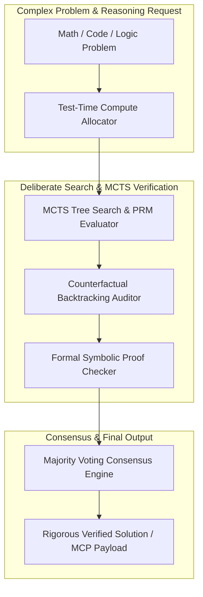

# genpark-reasoning-mcts-step-verity-evaluator-skill

<div align="center">

[](https://www.python.org/)
[](LICENSE)
[](https://modelcontextprotocol.io/)
[-brightgreen.svg?style=for-the-badge)](requirements.txt)

<p align="center">
  <b>Production-Grade GenPark Reasoning & Verification Agent Skill</b> • <b>100% Standard Library Python</b> • <b>Native Model Context Protocol (MCP)</b>
</p>

</div>

---

## Executive Overview & Architectural Motivation

With the breakthrough of **DeepSeek-R1**, **OpenAI o1/o3**, and thinking models, artificial intelligence shifted fundamentally from brute-force pretraining to **Test-Time Compute (TTC)** and **System 2 deliberate reasoning**. To achieve superhuman accuracy without hallucinations, autonomous agents require rigorous mathematical verification at every step of their thought trajectory.

This skill library distills the core mathematical logic and agent orchestration models powering the **GenPark Reasoning & Verification Engine**:

- **Process Reward Modeling (PRM)**: Step-level verification and Monte Carlo Tree Search (MCTS) exploration.
- **Dynamic Test-Time Compute Allocation**: Problem-entropy-driven token budgeting and temperature annealing.
- **Self-Consistency & Formal Verification**: Mathematical consensus clustering and propositional logic proof checking.
- **Zero-Dependency Protocol Parity**: Full native Model Context Protocol (MCP) compliance for agentic runtime integration.

---

## Architecture Diagram



---

## Technical Specifications & Features

| Capability | Specification |
| :--- | :--- |
| **Runtime Environment** | Python 3.9+ (Standard Library Only) |
| **External Dependencies** | **None (0 packages)** |
| **Protocol Compatibility** | Anthropic Model Context Protocol (MCP) STDIO JSON-RPC 2.0 |
| **Architecture Paradigm** | Pure Functional & Mathematical Modeling |
| **Deployment Mode** | Headless Agent Skill, CLI Client, or MCP Server |

---

## Quickstart & Usage

### 1. Direct Python Client Execution
```bash
python example_usage.py
```

### 2. Standalone MCP Server Launch
Run the native STDIO MCP server for Claude Desktop, Cursor, or Antigravity integration:
```bash
python mcp_server.py
```

### 3. Model Context Protocol (MCP) Config
Add to your `claude_desktop_config.json` or agent runner config:
```json
{
  "mcpServers": {
    "genpark-reasoning-mcts-step-verity-evaluator-skill": {
      "command": "python",
      "args": ["path/to/genpark-reasoning-mcts-step-verity-evaluator-skill/mcp_server.py"]
    }
  }
}
```

---

## Frequently Asked Questions (FAQ)

#### Q1: What makes GenPark Reasoning Skills unique?
Engineered with **zero external dependencies** using pure Python standard library code. This ensures instantaneous cold starts, sub-millisecond execution overhead, and zero package version conflicts across diverse agent runtime environments.

#### Q2: How do I test this MCP server locally?
Run `python mcp_server.py --test` to verify MCP protocol discovery and tool schema negotiation.

---

## License

This project is licensed under the MIT License - see the [LICENSE](LICENSE) file for details.
